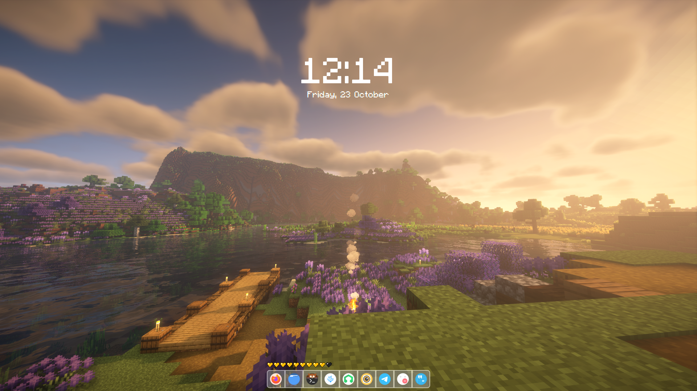
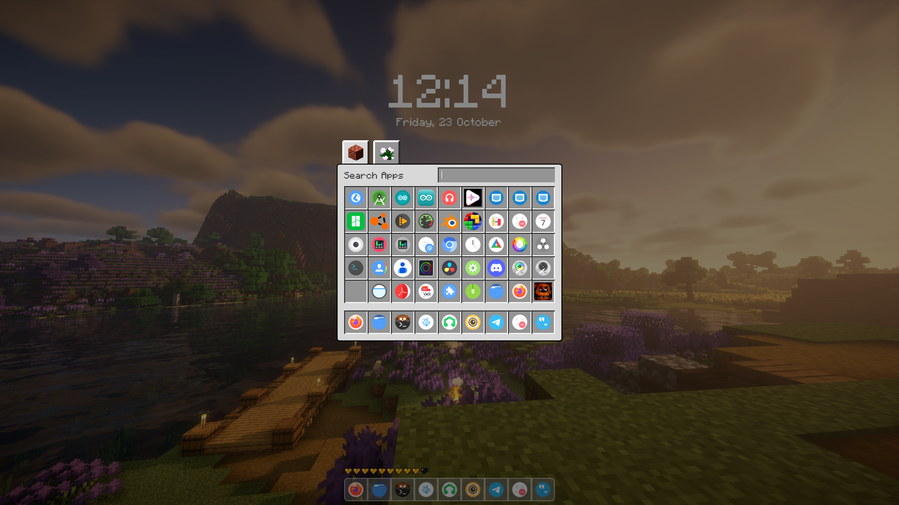
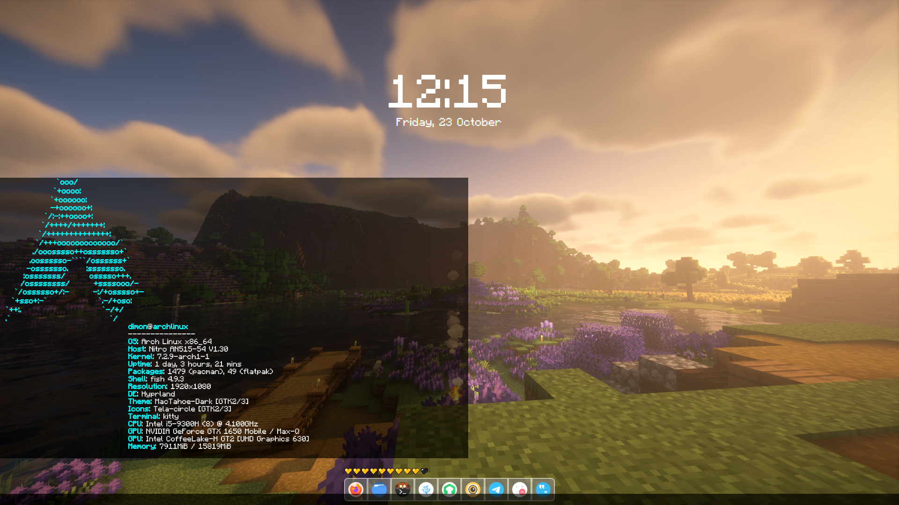

# Quickshell config in the style of Minecraft

This shell was made by Nelix. The main purpose of this project is to have fun.
It includes a launcher in the style of Minecraft inventory. Power manu in the style of pause menu in game.
And the coolest part, in my opinion, is a chat that catches all you notifications and turns them into Minecraft-style chat messages.

Check out the visual preview in the [Screenshots section](#screenshots) below.

## Watch the demo
[](https://www.youtube.com/watch?v=w0NpKxcDgfQ)

## Installation
The easiest way to install is to run install.sh

1. Open terminal
2. Copy repo
```bash
git clone https://github.com/lyb1g/mineland.git
```
3. Navigate into the directory
```bash
cd mineland
```
4. Make install.sh executable
```bash
chmod +x install.sh
```
5. Run install.sh
```bash
./install.sh
```

**The script will backup your current config (if it's there), so don't worry.**

## Settings
You need to set up a few things before usage.

**Hyprland binds**
```lua
hl.bind(mainMod .. " + E", hl.dsp.exec_cmd("qs ipc call launcher toggle"))       -- LAUNCHER
hl.bind(mainMod .. " + P", hl.dsp.exec_cmd("qs ipc call power toggle"))          -- POWER MENU
hl.bind(mainMod .. " + S", hl.dsp.exec_cmd("qs ipc call settings toggle"))       -- SETTINGS
hl.bind(mainMod .. " + T", hl.dsp.exec_cmd("qs ipc call chat toggle"))           -- OPEN CHAT (NOTIFICATIONS)
hl.bind(mainMod .. "+ SHIFT + J", hl.dsp.exec_cmd("qs ipc call chat clearAll"))  -- CLEAR CHAT
```

**Wallpaper directory**
1. Open
```
~/.config/quickshell/config.json
```
2. Change
```
"wallpapersDir": "_full_path_to_folder_"
```
3. Restart quickshell

**Autostart**

Add this to your Hyprland config
```lua
hl.on("hyprland.start", function () 
  hl.exec_cmd("qs")
end)
```

## Screenshots



